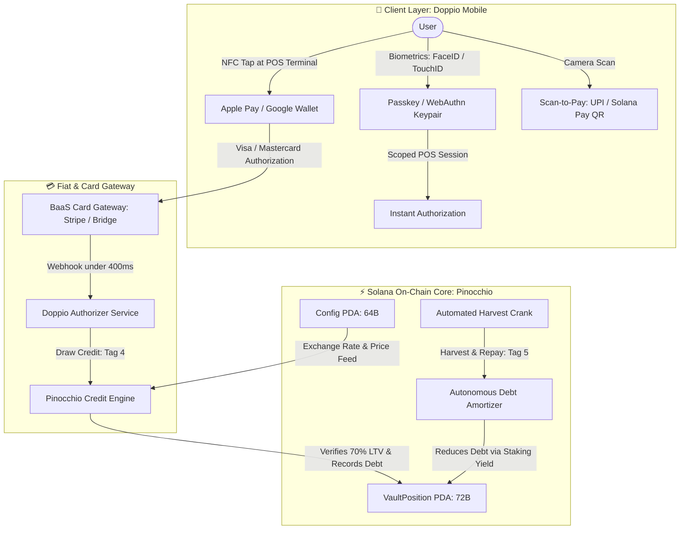

# ☕ Doppio: Double-Shot Crypto Credit

> **"Spend fiat today, let your staking yield pay off the balance."**

[](https://explorer.solana.com/address/4xu1Gz6G3zoEYqRffUNXcsfo4b4dDgEH5bRAm4UXmc3F?cluster=devnet)
[](https://github.com/anza-xyz/pinocchio)
[](https://github.com/anza-xyz/litesvm)
[](#minimal-binary-footprint)
[](#litesvm-test-suite)

Doppio is a non-custodial self-repaying credit protocol and neobank engine built on the Solana Virtual Machine (SVM). Users deposit Liquid Staking Tokens (such as JitoSOL), tap to pay in the real world via Apple Pay / NFC or scan QR payment rails (UPI / Solana Pay) against a 70% Loan-to-Value (LTV) credit line, and allow their staking yield to automatically extinguish their debt epoch-by-epoch.

---

## 🎯 The Core Problem & The Double-Shot Solution

### The "Asset-Rich, Cash-Poor" Dilemma
1. **The Capital Gains Tax Penalty:** Selling SOL or crypto for everyday purchases (coffee, groceries, travel) triggers taxable events (up to 30%+ capital gains) and destroys future upside and ~7.5% APY staking yields.
2. **Predatory FX & Cross-Border Fees:** Swiping traditional credit cards abroad incurs 3%–5% hidden foreign exchange markups and bank spreads.
3. **Point-of-Sale Popup Fatigue:** General-purpose wallets (Phantom, Solflare) rely on browser popups, simulation latency, and seed phrases that fail at physical retail checkout counters.
4. **Prepaid "Crypto Debit" Fallacy:** Existing crypto debit cards merely sell assets at checkout with high slippage—they provide no actual credit.

### The Doppio "Double-Shot" Model
* **Shot 1 (Yield-Bearing Collateral):** Deposit JitoSOL or LSTs into an on-chain zero-copy vault. Retain 100% of price upside and native staking yield.
* **Shot 2 (Zero-Friction Real-World Credit):** Draw up to 70% LTV in instantaneous purchasing power. Tap at any Visa/Mastercard terminal via Apple Pay or scan merchant QR codes.
* **The Self-Repaying Engine:** As JitoSOL accrues staking rewards, the exchange rate increases relative to SOL. The protocol's automated harvest crank amortizes outstanding debt without liquidating the user's primary collateral.

---

## 🏗️ High-Level Architecture



---

## ⚡ Smart Contract Specification

The smart contract is written entirely in **Pinocchio** (zero external dependencies, zero-copy deserialization), achieving an ultra-small SBF binary footprint and near-zero compute unit (CU) consumption.

### Program Deployment on Solana Devnet
* **Network:** Solana Devnet
* **Program ID:** [`4xu1Gz6G3zoEYqRffUNXcsfo4b4dDgEH5bRAm4UXmc3F`](https://explorer.solana.com/address/4xu1Gz6G3zoEYqRffUNXcsfo4b4dDgEH5bRAm4UXmc3F?cluster=devnet)
* **Upgrade Authority:** `B7dKfnjjpBmYrakj5j44nF4moQpZ8LHasAe7veUpNYUh`
* **Deployment Signature:** `3zKzUBe3217bnqHM8739JnESFoWZqqUmZKLD42xJqHzrLhT2wsYPybjDiiaFmtEsQ1cKip5HdnARtFXudMe1nQ87`

### Zero-Copy Account State Layouts

#### 1. Config PDA (`b"config"`) — Exactly 64 Bytes
Stores protocol parameters, admin authority, current LST exchange rate, and price feeds.

| Offset | Field | Type | Description |
|:---:|:---|:---:|:---|
| `0..8` | `discriminator` | `[u8; 8]` | Magic byte marker: `*b"dop_conf"` |
| `8..40` | `admin` | `Pubkey` | Protocol administrator authority (32 bytes) |
| `40..48` | `rate` | `u64` | Current exchange rate in 1e9 precision (e.g., `1_075_000_000` = 1.075 SOL/JitoSOL) |
| `48..56` | `price` | `u64` | Oracle price in micro-USDC 1e6 (e.g., `150_000_000` = $150.00) |
| `56` | `bump` | `u8` | Canonical PDA bump seed |
| `57..64` | `_reserved` | `[u8; 7]` | Zero-byte padding for strict 8-byte word alignment |

#### 2. VaultPosition PDA (`b"vault", user_pubkey`) — Exactly 72 Bytes
Isolated per-user vault recording collateral balance, drawn debt, and baseline exchange rate.

| Offset | Field | Type | Description |
|:---:|:---|:---:|:---|
| `0..8` | `discriminator` | `[u8; 8]` | Magic byte marker: `*b"dop_vpos"` |
| `8..40` | `owner` | `Pubkey` | Cardholder wallet public key (32 bytes) |
| `40..48` | `collateral` | `u64` | Deposited LST lamports (1e9 precision) |
| `48..56` | `debt` | `u64` | Outstanding credit drawn in micro-USDC (1e6 precision) |
| `56..64` | `rate` | `u64` | Exchange rate at last deposit/harvest checkpoint |
| `64` | `bump` | `u8` | Canonical PDA bump seed |
| `65..72` | `_reserved` | `[u8; 7]` | Zero-byte padding for strict 8-byte word alignment |

---

### Instruction Set (1-Byte Discriminator Dispatch)

| Tag | Opcode | Accounts Expected | Description |
|:---:|:---|:---|:---|
| `0` | `InitializeConfig` | `[admin (signer), config_pda (mut)]` | Initializes protocol parameters and oracle defaults |
| `1` | `SetExchangeRate` | `[admin (signer), config_pda (mut)]` | Fast-forwards / updates LST exchange rate |
| `2` | `InitializeVault` | `[user (signer), vault_pda (mut), config_pda]` | Derives and initializes user's isolated vault |
| `3` | `DepositCollateral` | `[user (signer), vault_pda (mut), config_pda]` | Deposits JitoSOL collateral into the ledger |
| `4` | `DrawCredit` | `[user (signer), vault_pda (mut), config_pda]` | Authorizes card tap ($8.50) subject to 70% LTV limit |
| `5` | `HarvestAndRepay` | `[vault_pda (mut), config_pda]` | Calculates accrued yield and amortizes debt |
| `6` | `SetPrice` | `[admin (signer), config_pda (mut)]` | Updates collateral asset price feed |
| `7` | `WithdrawCollateral` | `[user (signer), vault_pda (mut), config_pda]` | Withdraws collateral while enforcing 70% LTV safety |
| `8` | `RepayDebt` | `[user (signer), vault_pda (mut)]` | Manually repays outstanding debt |

---

## 🧮 Mathematical Engine

### 1. Collateral Valuation (USDC Micro-units)
$$\text{Collateral Value} = \frac{\text{Collateral (lamports)} \times \text{Exchange Rate} \times \text{SOL Price}}{10^9 \times 10^9}$$

### 2. Maximum Credit Limit (70% LTV)
$$\text{Borrow Limit} = \frac{\text{Collateral Value} \times 70}{100}$$
If $\text{Outstanding Debt} + \text{Drawn Amount} > \text{Borrow Limit}$, the transaction is rejected with `CreditLimitExceeded (6001)`.

### 3. Yield Calculation & Debt Amortization
When the exchange rate appreciates from $R_{\text{old}}$ to $R_{\text{new}}$:
$$\Delta R = R_{\text{new}} - R_{\text{old}}$$
$$\text{Yield in SOL} = \frac{\text{Collateral} \times \Delta R}{10^9}$$
$$\text{Yield in USDC} = \frac{\text{Yield in SOL} \times \text{SOL Price}}{10^9}$$

* **If $\text{Yield in USDC} \ge \text{Debt}$:**
  * Debt is wiped out completely to **$0.00**.
  * Base collateral is deducted by the precise share equivalent of the repaid debt:
    $$\Delta \text{Shares} = \frac{\text{Debt} \times 10^{18}}{\text{Price} \times R_{\text{new}}}$$
  * Vault checkpoint rate is set to $R_{\text{new}}$.
* **If $\text{Yield in USDC} < \text{Debt}$:**
  * Debt is reduced by the entire yield amount: $\text{Debt} \leftarrow \text{Debt} - \text{Yield in USDC}$.
  * Collateral is deducted by the yield shares.
  * Vault checkpoint rate is set to $R_{\text{new}}$.

---

## 🧪 LiteSVM Test Suite

The test suite is isolated in [`tests/`](file:///Users/manojkumarlakkala/Work/doppio/tests) and features a clean, modular architecture:

```text
tests/
├── Cargo.toml
└── src/
    ├── lib.rs
    ├── common/
    │   ├── mod.rs                  # Re-exports harness & solana SDK traits
    │   ├── constants.rs            # Seeds & magic byte discriminators
    │   ├── env.rs                  # DoppioTestEnv with LiteSVM harness
    │   ├── instructions.rs         # 8 instruction builders
    │   └── state.rs                # Zero-copy state mirror unpackers
    └── suites/
        ├── mod.rs                  # Test suite runner
        ├── math.rs                 # 70% LTV, collateral valuation & share math
        ├── layout.rs               # 64B & 72B memory alignment and sizes
        ├── instruction.rs          # 1-byte opcode unpacking & bounds checks
        ├── initialization.rs       # PDA inits & admin access controls
        ├── credit.rs               # Collateral deposits, $8.50 card taps & LTV limits
        ├── repay_withdraw.rs       # Manual repayments & safe withdrawals
        └── harvest.rs              # Automated self-repayment & multi-epoch yields
```

### Running the Test Suite

```bash
cargo test
```

**Output (28 passed in ~0.22s):**
```text
running 28 tests
test suites::credit::test_draw_credit_declined_over_limit_70_percent_ltv ... ok
test suites::credit::test_draw_credit_rejected_bad_signer_or_pda ... ok
test suites::credit::test_deposit_collateral_flow ... ok
test suites::harvest::test_harvest_and_repay_debt_reduced_when_yield_less_than_debt ... ok
test suites::credit::test_card_tap_and_draw_credit_approved_8_50 ... ok
test suites::harvest::test_harvest_and_repay_noop_when_no_yield ... ok
test suites::instruction::test_unpack_deposit_and_draw ... ok
test suites::instruction::test_unpack_initialize_config ... ok
test suites::instruction::test_unpack_invalid_cases ... ok
test suites::instruction::test_unpack_set_exchange_rate ... ok
test suites::credit::test_multiple_consecutive_card_taps ... ok
test suites::instruction::test_unpack_simple_instructions ... ok
test suites::instruction::test_unpack_withdraw_and_repay ... ok
test suites::layout::test_config_layout_and_size ... ok
test suites::layout::test_vault_position_layout_and_size ... ok
test suites::math::test_collateral_value_calculation ... ok
test suites::math::test_max_borrow_70_percent_ltv ... ok
test suites::math::test_yield_and_shares_calculation ... ok
test suites::math::test_zero_yield_when_rate_unchanged_or_lower ... ok
test suites::harvest::test_harvest_and_repay_debt_cleared_when_yield_exceeds_debt ... ok
test suites::harvest::test_complete_end_to_end_architecture_lifecycle ... ok
test suites::credit::test_exact_70_percent_ltv_boundary ... ok
test suites::initialization::test_admin_fast_forward_access_control ... ok
test suites::initialization::test_initialize_accounts_flow ... ok
test suites::initialization::test_double_initialization_rejected ... ok
test suites::harvest::test_multi_epoch_harvesting ... ok
test suites::repay_withdraw::test_manual_repay_debt_flow ... ok
test suites::repay_withdraw::test_withdraw_collateral_ltv_enforcement ... ok

test result: ok. 28 passed; 0 failed; 0 ignored; finished in 0.22s
```

---

## 🚀 Building & Deploying

### Prerequisites
* Rust 1.80+ (`rustup default stable`)
* Solana CLI tools (`solana-cli` or `agave-install`)

### 1. Build Contract with SBF
```bash
cargo build-sbf --manifest-path program/Cargo.toml
```
The optimized shared object will be output to `target/deploy/program.so` (**~19 KB**).

### 2. Deploy to Solana Devnet
```bash
solana program deploy target/deploy/program.so \
  --url https://api.devnet.solana.com \
  --keypair ~/.config/solana/id.json
```

---

## 📂 Repository Directory Layout

```text
doppio/
├── Cargo.toml                       # Root workspace declaration
├── README.md                        # Master project documentation
├── program/                         # Pinocchio smart contract
│   ├── Cargo.toml
│   └── src/
│       ├── lib.rs                   # Module declarations & Program ID
│       ├── entrypoint.rs            # Native SVM entrypoint
│       ├── instruction.rs           # 1-byte opcode decoding & DoppioInstruction
│       ├── state.rs                 # Zero-copy Config & VaultPosition PDAs
│       ├── math.rs                  # Pure integer math for 70% LTV & yield
│       ├── error.rs                 # Custom program error codes (6000-6007)
│       └── processor/               # Modular instruction handlers
│           ├── mod.rs
│           ├── initialize_config.rs
│           ├── set_exchange_rate.rs
│           ├── initialize_vault.rs
│           ├── deposit_collateral.rs
│           ├── draw_credit.rs
│           ├── harvest_and_repay.rs
│           ├── withdraw_collateral.rs
│           └── repay_debt.rs
├── tests/                           # LiteSVM Integration Test Suite
│   ├── Cargo.toml
│   └── src/
│       ├── lib.rs                   # Test crate entrypoint
│       ├── common/                  # LiteSVM harness & helpers
│       └── suites/                  # Categorized unit & integration tests
└── app/                             # Native Doppio Mobile Application
```

---

## 🔒 Security & Safety Guarantees

* **Isolated Vault Architecture:** Each user maintains an individual PDA (`b"vault", user_pubkey`). Systemic contagion is mathematically impossible because user pools are not pooled in shared debt tranches.
* **Non-Custodial:** Only the vault owner can draw credit, withdraw collateral, or execute manual repayments.
* **Strict 70% LTV Hardcap:** Collateral withdrawals and credit draws dynamically check the LTV boundary, declining any operation that would reduce collateral backing below 70%.
* **Reentrancy Immunity:** State mutations occur strictly before CPI dispatches, adhering to standard Checks-Effects-Interactions patterns.
